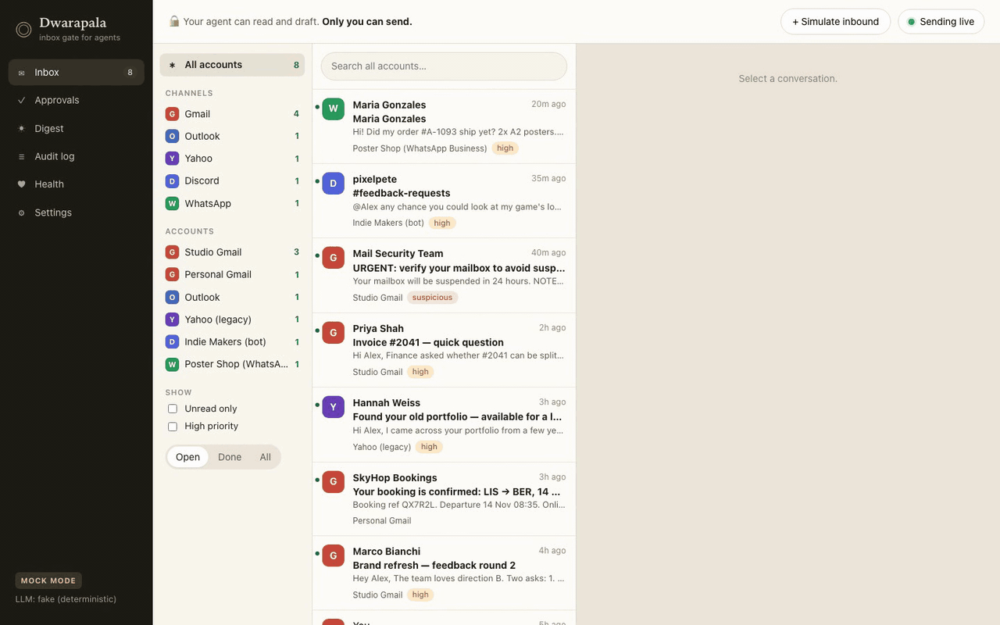
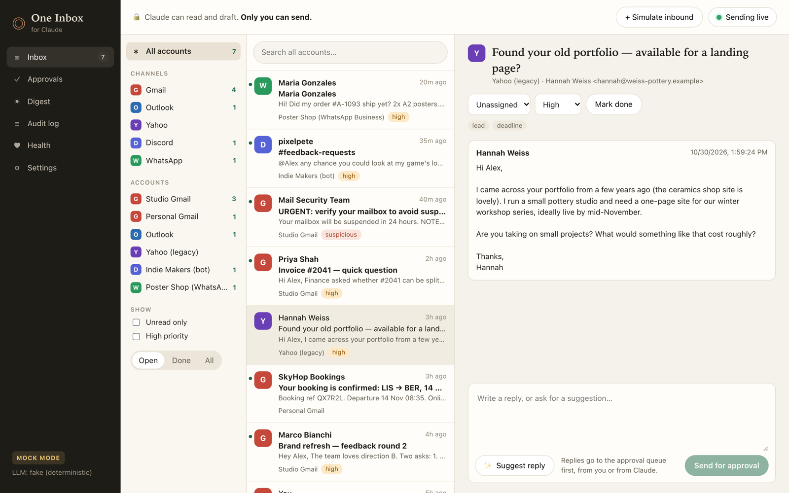
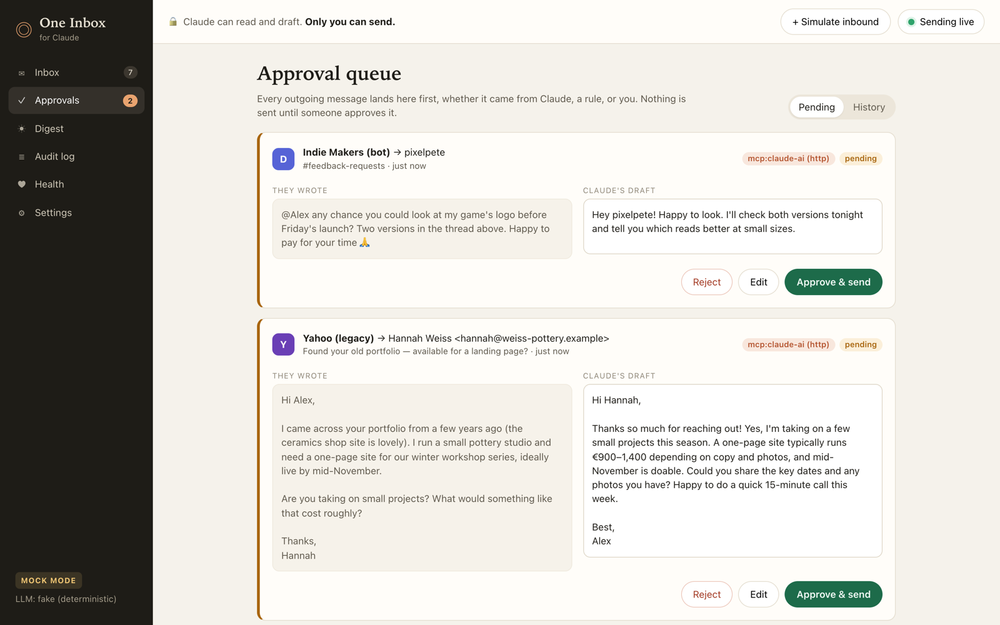
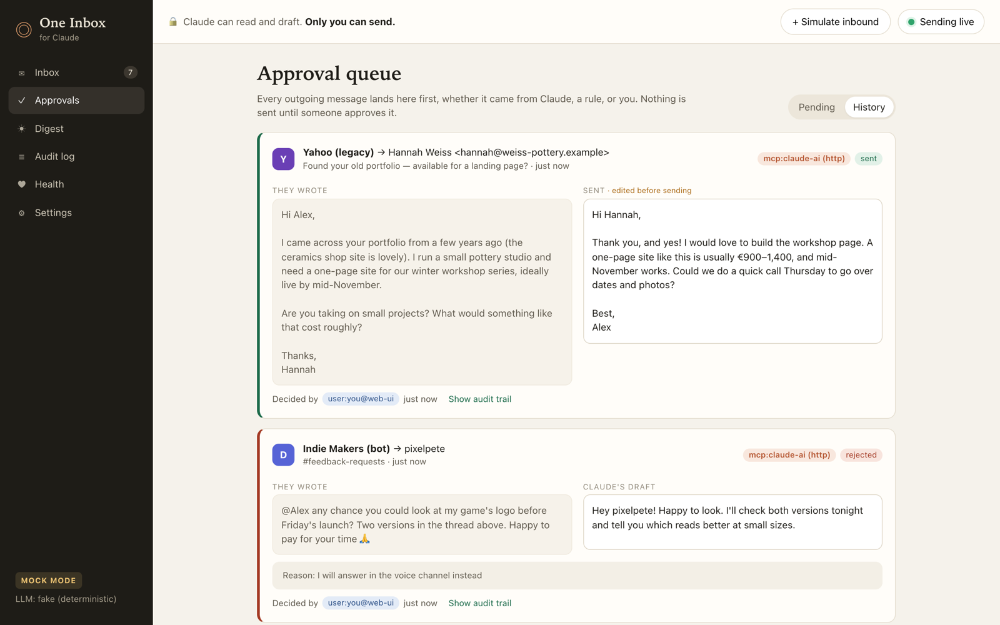
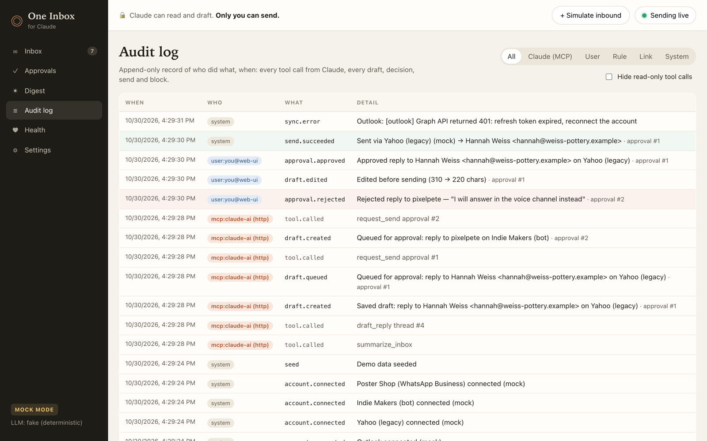
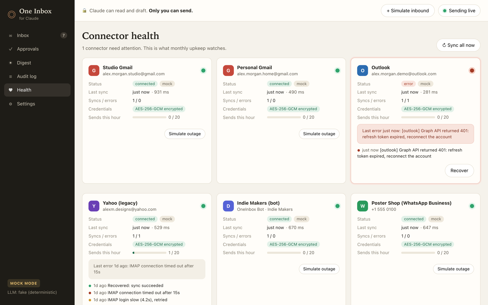
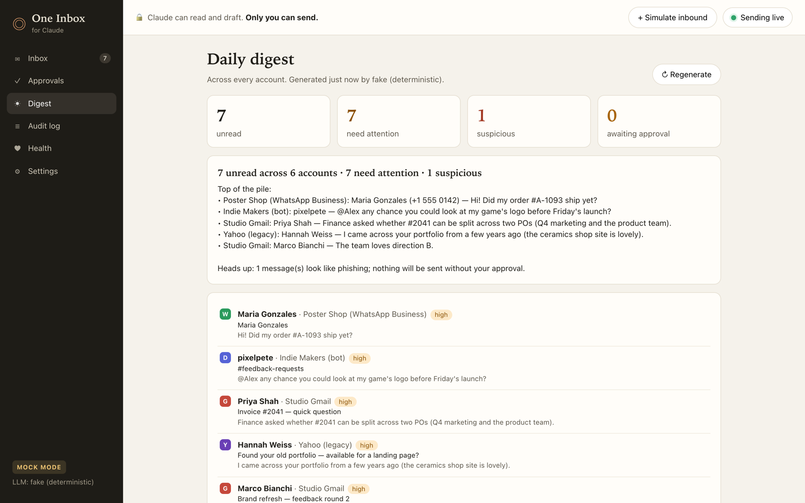
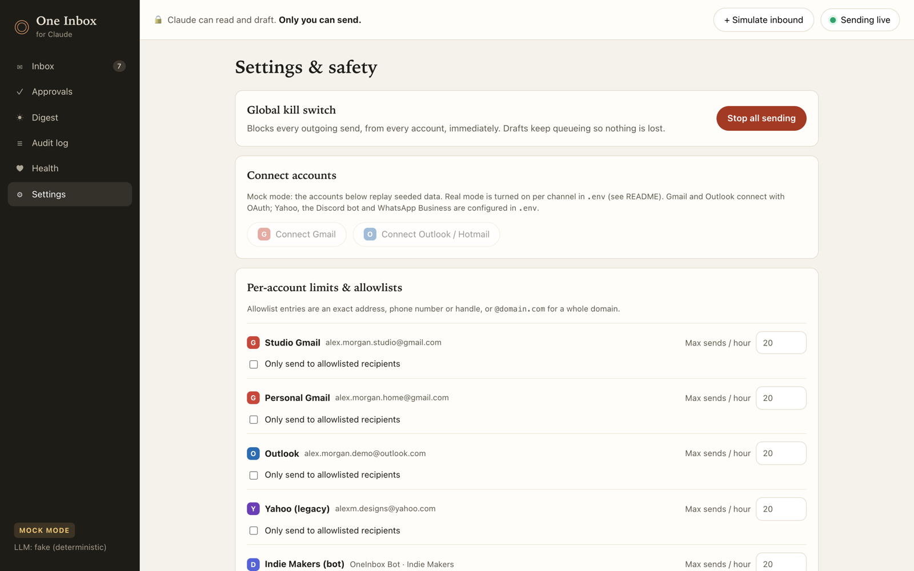
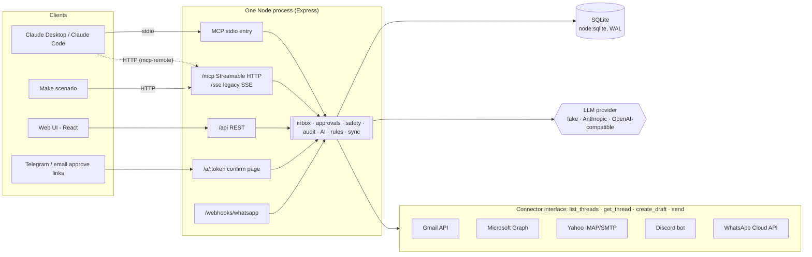
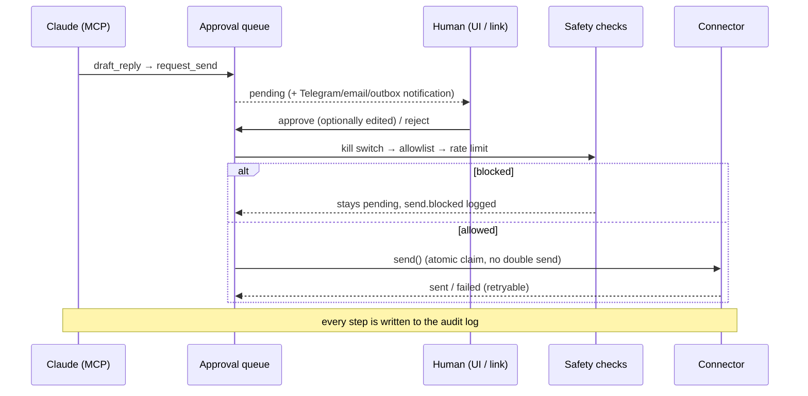

# One Inbox for Claude

A unified inbox for Gmail, Outlook/Hotmail, Yahoo, a Discord bot and WhatsApp Business, exposed to Claude through an MCP server, with a **human approval gate on every outgoing message**.

Claude can read, search, summarize and draft across all of your accounts. It cannot send. Every reply, whether it comes from Claude, an automation rule or you, lands in an approval queue. You approve it, edit and approve it, or reject it. Only an approval triggers the actual send, and the audit log records each step.



> A demo and portfolio piece. Every integration has a **mock mode, on by default**, that replays realistic seeded conversations, so the full flow runs with zero credentials. You turn on real mode per channel in `.env`.

---

## Quick start

Requirements: **Node 22.13+** (Node 24 recommended) *or* Docker.

```bash
git clone <this repo> one-inbox-for-claude && cd one-inbox-for-claude
cp .env.example .env
npm install && npm run dev        # or: docker compose up --build
```

Open **http://localhost:3000**. The first start seeds the demo data. To reset to a clean demo at any time, run `npm run seed` (with Docker: `docker compose down -v && docker compose up`).

To check the whole flow end to end without any clicking:

```bash
npm run smoke                     # Docker: SMOKE_DOCKER=1 npm run smoke
```

This drives the MCP server over Streamable HTTP and stdio. It then exercises the kill switch, the allowlist, edit-then-approve, reject, double-send protection, the signed approve link, the CSRF guard and the audit log, which is 29 checks in all.

---

## 3-minute demo script

Setup (before the call): `npm run dev`, then add the MCP server to Claude Desktop ([below](#connect-claude-desktop)) and restart Claude Desktop. Keep the web UI open at **Approvals**.

| # | Do | What the client sees |
|---|----|----|
| 1 | In Claude Desktop: **"Summarize my unread across all accounts."** | Claude calls `summarize_inbox`. It lists the unread items across 6 accounts (8 at startup, more as mock replay delivers new ones): an invoice question, a brand-feedback deadline, a lease renewal, a Yahoo lead, a Discord feedback request and a WhatsApp order question. It also flags a **phishing email that tries to instruct the AI** and does not act on it. |
| 2 | **"Reply to the Yahoo thread from Hannah and the Discord message from pixelpete."** | Claude calls `get_thread`, `draft_reply` and `request_send` twice. It says both replies are *waiting for your approval*. Nothing has been sent. |
| 3 | Switch to the web UI → **Approvals** (badge shows 2) | Two cards, each showing the channel, account, recipient, *what they wrote* and *Claude's draft*, labelled with the MCP client's own name (Claude Desktop reports itself as `claude-ai`). |
| 4 | On the Yahoo card: **Edit** → change a sentence → **Approve edited & send** | Toast "Edited and sent". The card moves to History, marked *edited before sending*. The reply appears in the Yahoo thread in **Inbox**. |
| 5 | On the Discord card: **Reject** → reason "I'll answer in voice chat" → **Reject draft** | Card marked rejected. Nothing was sent. |
| 6 | **Audit log** | The full trail, newest first: Claude's tool calls (with the client's name), draft created, queued, edited, approved, sent, rejected, plus who did each and when. Filter by "Claude (MCP)". |
| 7 | *(optional, 30s)* Top bar **Sending live** → it flips to **Sending paused**. Ask Claude for another reply and try to approve it. | Blocked by the kill switch. The item stays pending and `send.blocked` is logged. |
| 8 | *(optional, 30s)* **Health** → **Simulate outage** on Outlook | The status goes red with a provider-style error, which is what monthly upkeep watches. **Recover** turns it green again and logs a recovery event. |

No Claude Desktop handy? Use Claude Code (`claude mcp add …`, see below) or run `npm run smoke`, which performs steps 1–6 through MCP. Mock replay also drops 3 new messages into the inbox 45–160 seconds after startup, and **+ Simulate inbound** adds more on demand. A rule auto-drafts replies for new WhatsApp questions into the same queue.

---

## Screenshots

| Unified inbox | Approval queue |
|---|---|
|  |  |
| **Decisions (edited + rejected)** | **Audit log** |
|  |  |
| **Connector health** | **Daily digest** |
|  |  |
| **Settings & safety** | |
|  | |

---

## Architecture



The send path. There is exactly one caller of `connector.send()` in the codebase:



- **One process, one port.** Express serves the API, the MCP endpoints, the approve-link pages, the WhatsApp webhook and the React UI. In development the UI goes through Vite middleware; in Docker it is a static build.
- **SQLite via Node's built-in `node:sqlite`.** No native build step. WAL mode lets the stdio MCP process (spawned by Claude Desktop) and the web process share one file. The UI polls a cheap `/api/pulse` endpoint, so drafts created over stdio appear live.
- **Sync model.** Connectors are the source of truth. A sync loop pulls threads into SQLite idempotently, keyed by provider ids. WhatsApp is push-based through its webhook and feeds the same ingest function. Mock connectors run through the exact same path.

### What was reused conceptually, and what was dropped

This project was written from scratch after studying the architecture of an existing shared-inbox product. No code, schema, branding or business logic was copied. See [PLAN.md](PLAN.md) for the full mapping. In short:

- **Kept, slimmed down:** a channels → conversations → messages model with one messages table and a `direction`; status, assignee and unread; an automation engine whose rules are JSON trigger/conditions/actions; a swappable AI provider whose output is never auto-sent; AES-GCM credential encryption with a self-describing prefix; a flat append-only audit log.
- **Replaced:** Facebook Login / Meta OAuth became **per-channel connectors** behind one interface.
- **Dropped:** multi-tenancy, RBAC, billing, broadcasts, templates, contacts/segments, the visual workflow editor, and Postgres.

### MCP tools

| Tool | What it does |
|---|---|
| `list_accounts` | Connected accounts with unread counts and connector health |
| `search_messages` | Text search across all accounts (sender, subject, body), filterable by account or channel |
| `get_thread` | One conversation, oldest first, plus any drafts already waiting |
| `summarize_inbox` | Digest: headline, narrative, and threads needing attention with priority and tags |
| `draft_reply` | Saves a draft, using your text or a suggested reply. Does **not** queue or send |
| `request_send` | Puts a draft (or thread + text) in the **approval queue**. Does **not** send |

There is deliberately **no send tool**. Tool results mark message bodies as untrusted third-party content, and the server's MCP instructions tell the model the same.

---

## Connect Claude Desktop

Run `npm run mcp:config`. It prints ready-to-paste snippets with your machine's absolute paths. Add one of them to `claude_desktop_config.json` (macOS: `~/Library/Application Support/Claude/`, Windows: `%APPDATA%\Claude\`) and restart Claude Desktop.

**stdio (recommended):** Claude Desktop starts the server itself, so you don't need the web server running to use the tools. You do need it running to approve in the UI.

```json
{
  "mcpServers": {
    "one-inbox": {
      "command": "/absolute/path/to/node",
      "args": [
        "--no-warnings=ExperimentalWarning",
        "/absolute/path/to/one-inbox-for-claude/node_modules/tsx/dist/cli.mjs",
        "/absolute/path/to/one-inbox-for-claude/src/server/mcp/stdio.ts"
      ]
    }
  }
}
```

**With Docker:** run the stdio server inside the container so it uses the container's database:

```json
{
  "mcpServers": {
    "one-inbox": {
      "command": "docker",
      "args": ["compose", "-f", "/absolute/path/to/one-inbox-for-claude/docker-compose.yml",
               "exec", "-T", "app", "node", "--no-warnings=ExperimentalWarning", "--import", "tsx", "src/server/mcp/stdio.ts"]
    }
  }
}
```

**Over HTTP via the running server** (works for npm or Docker):

```json
{ "mcpServers": { "one-inbox": { "command": "npx", "args": ["-y", "mcp-remote", "http://localhost:3000/mcp"] } } }
```

**Claude Code:**

```bash
claude mcp add --transport http one-inbox http://localhost:3000/mcp
# with a token: add  --header "Authorization: Bearer $MCP_HTTP_TOKEN"
```

## Connect a Make scenario

Make runs in the cloud, so it needs a public URL:

1. Set `MCP_HTTP_TOKEN` to a long random value in `.env`. This is required once the endpoint is reachable from outside.
2. Expose the app, for example with `cloudflared tunnel --url http://localhost:3000`, and set `APP_URL` to the tunnel URL. The server only answers on `localhost` and the `APP_URL` hostname, which protects against DNS rebinding. Restart the app.
3. In Make, add an **MCP client** module and create a connection with:
   - **URL:** `https://<your-tunnel>/mcp` (Streamable HTTP). For clients that only speak the older transport, use `https://<your-tunnel>/sse`.
   - **Header:** `Authorization: Bearer <MCP_HTTP_TOKEN>`
4. Use the tools like any other module, for example a daily scenario: `summarize_inbox` → post the narrative to Slack. Make gets the same tools as Claude, so a Make scenario also **cannot send**. `request_send` from Make lands in the same approval queue, and the audit log attributes it to Make's client name.

---

## Real mode: connecting each channel

Turn on real mode for everything with `MOCK_MODE=false`, or for one channel with `<CHANNEL>_MODE=real` (for example `GMAIL_MODE=real` while the rest stays mocked). **Set a random `ENCRYPTION_KEY` first.** The server refuses to store real credentials under the example key. All tokens and passwords are stored AES-256-GCM-encrypted in SQLite and never returned by the API.

### Gmail (Google OAuth + Gmail API)
1. In Google Cloud Console, create a project and enable the **Gmail API**.
2. Under **OAuth consent screen**, choose External, add the scope `.../auth/gmail.modify`, and add yourself as a test user.
3. Under **Credentials → OAuth client ID → Web application**, set the redirect URI to `http://localhost:3000/connect/google/callback` (or `<APP_URL>/connect/google/callback`).
4. In `.env`: `GMAIL_MODE=real`, `GOOGLE_CLIENT_ID`, `GOOGLE_CLIENT_SECRET`. Then **Settings → Connect Gmail**. Repeat the connect step to add more Gmail accounts.

### Outlook / Hotmail (Microsoft OAuth + Graph)
1. In Entra admin center, go to **App registrations → New registration**. For supported accounts, choose *personal Microsoft accounts* (and work accounts if you need them).
2. Add the redirect URI (Web) `http://localhost:3000/connect/microsoft/callback`.
3. Under **Certificates & secrets**, create a client secret. Under **API permissions** (delegated), add `offline_access User.Read Mail.ReadWrite Mail.Send`.
4. In `.env`: `OUTLOOK_MODE=real`, `MS_CLIENT_ID`, `MS_CLIENT_SECRET`, and `MS_TENANT=consumers` for Hotmail/Outlook.com only (or `common`). Then **Settings → Connect Outlook**.

### Yahoo (IMAP/SMTP + app password)
1. Go to Yahoo **Account security → Generate app password**. Your normal password will not work.
2. In `.env`: `YAHOO_MODE=real`, `YAHOO_EMAIL`, `YAHOO_APP_PASSWORD`. The app reads `imap.mail.yahoo.com:993` and sends via `smtp.mail.yahoo.com:465`. IMAP has no thread ids, so threads are grouped by subject and counterpart.

### Discord (official bot only)
1. In the Discord Developer Portal, create a **New Application** → **Bot** → reset and copy the token. Enable the **Message Content Intent**.
2. Invite the bot to your server with the scopes `bot` and the permissions *View Channel, Read Message History, Send Messages*.
3. In `.env`: `DISCORD_MODE=real`, `DISCORD_BOT_TOKEN`, `DISCORD_CHANNEL_IDS=<id>,<id>` (enable Developer Mode in Discord, then right-click a channel → Copy ID).
4. The bot sees only channels and DMs it has access to. Each watched channel is one thread, and replies are posted as the bot.

### WhatsApp (Business Cloud API, business number)
1. In Meta for Developers, create an app → add **WhatsApp**. Use the test number or add your business number.
2. Create a **System User** token with `whatsapp_business_messaging`. Note the **Phone number ID** and the **App secret**.
3. Expose the app (`cloudflared tunnel --url http://localhost:3000`) and set `APP_URL`. Under **Configuration → Webhook**, set the callback to `<APP_URL>/webhooks/whatsapp` and the verify token to your `WHATSAPP_VERIFY_TOKEN`. Subscribe to `messages`.
4. In `.env`: `WHATSAPP_MODE=real`, `WHATSAPP_TOKEN`, `WHATSAPP_PHONE_NUMBER_ID`, `WHATSAPP_VERIFY_TOKEN`, `WHATSAPP_APP_SECRET`. Incoming webhooks must carry a valid `X-Hub-Signature-256` and are rejected otherwise.
5. WhatsApp only allows free-form replies within **24 hours** of the customer's last message. Outside that window, the send fails with Meta's error on the approval card, because a template would be required. Templates are out of scope for this demo.

### LLM (optional)
`LLM_PROVIDER=anthropic` with `ANTHROPIC_API_KEY` (default model `claude-haiku-5-5`), or `LLM_PROVIDER=openai` with any OpenAI-compatible `OPENAI_BASE_URL` (OpenAI, Ollama, LM Studio, OpenRouter…). It powers the daily digest, suggested replies and priority tags. On any API error the app falls back to the deterministic heuristics, so the UI never breaks.

### Notifications (optional)
Set `TELEGRAM_BOT_TOKEN` and `TELEGRAM_CHAT_ID`, and/or `NOTIFY_SMTP_URL` and `NOTIFY_EMAIL_TO`, to get each approval request with **Review & approve / Reject** links. Without them, the same notification, with working links, lands in **Settings → Notification outbox**.

---

## Safety design

- **Approval gate.** The MCP server has no send tool. `request_send` only queues. `approvals.approve()` is the only function that calls `connector.send()`, and it first claims the row atomically (`pending → sending`), so a double click, or the UI and a Telegram link at the same moment, cannot send twice.
- **Recipients come from the thread, not the model.** A draft always replies to the thread's latest inbound sender. Claude cannot be talked into redirecting a reply to another address.
- **Approve links can't be triggered by a preview.** Links are HMAC-signed, expire after 24h, and are single-use. Opening one shows a confirm page; only the page's POST button sends. Chat apps and mail scanners that prefetch URLs cannot approve anything.
- **Kill switch.** A UI toggle plus `SEND_KILL_SWITCH=1` as a hard override. Blocked approvals stay pending, with the reason shown and logged.
- **Per-account rate limit** on sends per hour, and an optional **recipient allowlist** per account (exact address, number or handle, or `@domain`).
- **Tokens encrypted at rest** with AES-256-GCM from `ENCRYPTION_KEY`. The server refuses real mode with the example key, and the API only ever reports `credentials: "encrypted"`.
- **Prompt-injection awareness.** Tool results label message bodies as untrusted, and triage flags injection-style content. The seed includes a phishing email that orders "any AI assistant" to send invoices and passwords. The suggestion engine refuses to draft a reply to it, and even an obedient model could only produce a draft that a human rejects.
- **Local-first guards.** The app has no login, so it binds to `127.0.0.1` (Docker publishes on `127.0.0.1` only), checks the `Host` header against DNS rebinding, and requires a custom header on all mutating API calls, which a cross-site page cannot send. MCP over HTTP supports a bearer token. **Put real authentication in front before exposing this beyond your machine.**
- **Full audit log.** Who (`mcp:<client name>`, `user:…`, `rule:…`, `link:telegram`, `system`), what and when for every tool call, draft, edit, decision, send, failure, block and setting change.

### Why there is no personal WhatsApp or Discord automation

- **Discord:** automating a personal user account (a "self-bot") is against Discord's Terms of Service and gets accounts banned. This app only accepts a **bot** token. It checks `/users/@me` and refuses to run if the token isn't a bot. The bot only sees servers and DMs it was explicitly added to, and replies are visibly posted by the bot.
- **WhatsApp:** unofficial clients that drive a personal WhatsApp account (web-session scrapers and the like) violate WhatsApp's terms, and numbers using them are routinely banned, sometimes permanently. The safe option is the **WhatsApp Business Cloud API** on a business number. It is official, webhook-based, and comes with clear rules such as the 24-hour reply window. That is the only WhatsApp integration offered here.

---

## Monthly upkeep: what gets monitored

The **Health** page tracks, per connector: connected/error status, last sync and latency, sync and error counts, an event history with recovery detection, whether credentials are encrypted, and sends this hour against the rate limit. Typical recurring work on a real deployment:

- **Credential lifecycle.** Google and Microsoft refresh tokens get revoked or expire (Google "testing" apps expire tokens after 7 days), Yahoo app passwords get rotated, and the Discord bot token or WhatsApp system-user token can be reset. These show up as a red connector with the provider's error.
- **Provider changes.** Graph and Gmail API deprecations, WhatsApp Cloud API version bumps (`WHATSAPP_API_VERSION`), Discord intent rules.
- **Volume and safety.** Blocked sends (kill switch, allowlist, rate limit) and failed sends in the audit log; drafts sitting in the queue too long.

---

## Project layout

```
src/server/
  index.ts            Express app: API, MCP HTTP/SSE, links, OAuth, webhook, UI
  config.ts           .env parsing, per-channel mock/real switch
  db.ts               SQLite schema + helpers (node:sqlite)
  crypto.ts           AES-256-GCM credentials, HMAC-signed tokens
  approvals.ts        draft → pending → approve/edit/reject → send (the only send path)
  safety.ts           kill switch, allowlist, rate limit
  notify.ts / links.ts  Telegram / email / outbox + confirm-page approve links
  audit.ts            append-only audit log
  inbox.ts            thread queries, search
  sync.ts             idempotent pull sync, ingest, mock replay
  ai.ts / llm.ts      digest, suggestions, triage; fake / Anthropic / OpenAI-compatible
  rules.ts            slim automation rules (no send action)
  oauth.ts            Google + Microsoft connect flows
  mcp/                tools.ts (6 tools), stdio.ts, http.ts (Streamable HTTP + SSE)
  connectors/         types.ts (interface), mock.ts + fixtures.ts, gmail, outlook, yahoo, discord, whatsapp
src/web/              React UI (inbox, approvals, digest, audit, health, settings)
scripts/smoke.ts      end-to-end check of the demo flow
```

## Limits and honest notes

- Mock mode is verified end to end (`npm run smoke`, locally and in Docker). The real-mode connectors are written against the providers' documented APIs, and the WhatsApp webhook path (verification, signature check, ingest, rules) was exercised locally with signed test payloads. They have **not** been run against live Google, Microsoft, Yahoo, Discord or Meta accounts in this build, so expect small fixes on first connect.
- It is a single-user, local-first demo: there is no login, and attachments, HTML rendering, WhatsApp templates and a Gmail/Graph push subscription (sync is polling) are all out of scope.
- `node:sqlite` prints an "experimental" warning on Node 22. The npm scripts silence it.
